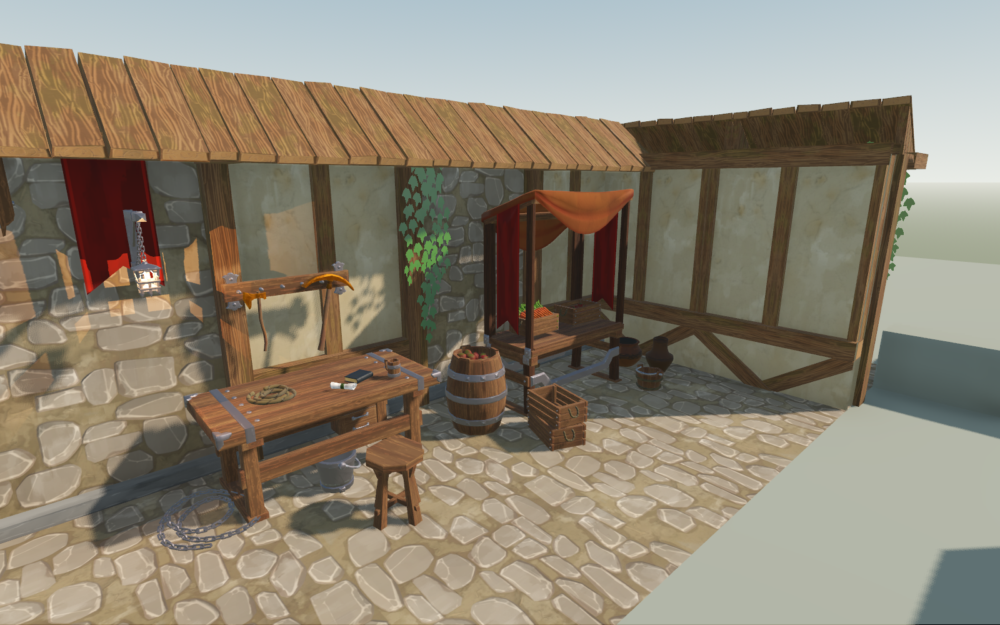

# Godot EnvArt Agent Pipeline

面向关卡设计师的环境美术 Agent 管线：输入白盒、设计约束与美术参考，优先复用可商用素材，必要时通过 Blender 适配或制作，再在 Godot 中装配和验证场景。

当前主场景是 **真实素材局部样板：门洞、坡道、墙边道具区**，使用 Quaternius 三套 CC0 Standard 免费包。新增墙脚灌木、草簇和小花，以及程序化装配的外围聚落、林地和山丘；其他可玩测试几何仍保留白盒；本版等待用户美术审阅。通用自动检索和 Blender 适配管线尚未实现。



[局部样板 HTML 图文说明与实机截图](docs/local-asset-sample.html)。首轮三风格案例于 2026-11-12 未通过用户美术验收，仍保存在 `envart/envart_lab.tscn`，仅作历史技术试验。

## 快速开始

1. 使用 **Godot 4.7.2 标准版**导入 `GodotProject/envart-pipline/project.godot`。项目使用 GDScript，无需 .NET 或第三方插件。
2. 等待首次资源导入完成，按 **F5** 运行主场景 `envart/local_sample/local_sample.tscn`。
3. 点击画面捕获鼠标，按 **Esc** 释放。也可以直接按 **4** 进入轨迹视角，再按 **P** 播放。

启动后停在门洞观察机位。按 **5 / 6 / 7** 查看门洞、坡道、墙边道具，**8** 查看远景，**B** 开关远景，**0** 切换白盒对照，**H** 隐藏操作提示。按 **1 / 2** 回到玩家视角试玩。原始 `demo/controller_lab.tscn` 与历史 `envart/envart_lab.tscn` 保留，可单独 F6 运行。

当前使用 Forward+ 渲染与 Jolt Physics。其他引擎版本、渲染后端和目标平台尚未完成兼容性验证。

> 有 Unity 经验但不熟悉 Godot？先阅读 [轨迹相机 HTML 图文教程](docs/rail-camera-guide.html)。将仓库克隆到本地后，用浏览器打开这个 HTML；无需启动服务器，保留旁边的 `images` 文件夹即可离线阅读。GitHub 文件页面显示的是 HTML 源码。

## 操作速查

| 操作 | 输入 |
| --- | --- |
| 移动、观察 | WASD、鼠标 |
| 奔跑 / 自由观察加速 | 按住 Shift |
| 玩家跳跃 | Space |
| 第一 / 第三人称 | 1 / 2；V 切换 |
| 自由观察 / 返回玩家视角 | F 或 3 |
| 自由观察升降 | E / Q |
| 第三人称距离 / 飞行速度 | 滚轮 |
| 玩家返回出生点 | R |
| 轨迹相机 / 返回进入前视角 | 4 |
| 轨迹播放 / 暂停 | P |
| 轨迹回到起点并暂停 | Home |
| 轨迹前后定位 1 秒 | [ / ] |
| 轨迹循环开关 | L |
| 释放鼠标，操作巡检面板 | Esc |
| 门洞 / 坡道 / 墙边道具观察机位 | 5 / 6 / 7 |
| 远景观察机位 / 开关远景 | 8 / B |
| 切换白盒对照 / 隐藏提示 | 0 / H |

玩家和自由观察操作需要鼠标捕获；轨迹快捷键在鼠标释放时也有效。切出轨迹视角会暂停并保留进度。样例巡检长 24 秒，在 8–10 秒停留，路径和关键帧可在编辑器调整。

## 功能与模块边界

- **角色移动**：独立配置身体尺寸、行走、冲刺、跳跃和坡面参数；移动模块不读取键鼠输入。
- **玩家相机**：第一人称眼高机位、第三人称弹簧臂避障、可脱离角色的自由观察。
- **轨迹相机**：原生 Path3D、PathFollow3D 与 AnimationPlayer；支持路径方向或注视目标、FOV 动画、播放暂停、时间定位和循环。
- **试玩环境**：测试坡道、门洞、跳台与相机遮挡，提供出生复位和运行时巡检面板。

当前没有自动跨台阶、蹲伏、攀爬或手柄映射。视角采用直接切换；自由观察和轨迹相机没有自动避障。开放轨迹开启循环时会从终点切回起点。

玩家已接入 Mixamo Mannequin 人形骨架和 idle / walking / running / jump。动画只读取实际速度与落地状态，不驱动物理位移；第一人称自动隐藏模型。默认行走速度为 4.5 m/s，视觉上已进入跑步步态；低于 2.6 m/s 使用行走步态。

**本机角色素材已安装。** Mixamo 允许在游戏中使用，但不能因此视为 CC0 素材；本项目不把原始 FBX 或派生角色资源提交为可公开再分发的素材。重新克隆后会使用胶囊占位，需要按 HTML 案例中的步骤下载并安装自己的 Mixamo 文件：

```sh
python3 tools/install_mixamo.py \
  --character ~/Downloads/Ch36_nonPBR.fbx \
  --locomotion "$HOME/Downloads/Basic Locomotion Pack.zip" \
  --running ~/Downloads/Running.fbx
```

安装器只读取这三个指定文件，核对二进制 FBX 格式，复制所需五个文件到已忽略的 `characters/mixamo_local/`，写入 SHA-256 清单，再调用 Godot 导入与构建。可用 `--godot` 指定其他 Godot 安装位置。

## 目录结构

```text
GodotProject/envart-pipline/
├── project.godot       # 引擎项目与输入动作
├── controllers/        # 角色配置、运动、输入和相机组件
├── demo/               # 测试场、网格材质、巡检面板
├── envart/             # 局部真实素材样板、历史三风格场景、CC0 素材
├── characters/         # 人形动画适配器与本地 Mixamo 构建工具
└── tests/              # 物理、轨迹与图形输入验证
docs/
├── pipeline-foundation.md
├── player-controller.md
├── camera-path-research.md
├── rail-camera-guide.html
└── images/             # 文档截图，随文档一起提交
```

Godot 中的 `res://` 指向 `project.godot` 所在目录，不是仓库根目录。

## 远景与植物

地面植物使用 Quaternius Stylized Nature MegaKit 的真实灌木、草、三叶草、蕨类和花朵模型，以固定种子分簇摆放并避开门洞、坡面与大件道具。远景由 11 栋模块房屋、460 棵实例化树木与连续程序化山地组成，独立保存在 `envart/local_sample/backdrop.tscn`，没有玩法碰撞。

在 Godot 检查器中编辑 `envart/local_sample/backdrop_config.tres` 可设置种子、树木数量、地形范围和山丘高度。修改后需运行 `res://envart/tools/build_backdrop.gd` 重新烘焙，**该命令不要加 `--headless`**：MultiMesh 实例缓冲需要真实图形后端才能正确序列化。生成器会拒绝无图形模式，避免覆盖有效场景。运行时只加载产物，不逐帧生成。

## 验证

在仓库根目录执行以下命令。macOS 默认引擎位置如下；其他安装位置请调整 `GODOT_BIN`。

```sh
GODOT_BIN=/Applications/Godot.app/Contents/MacOS/Godot

# 首次克隆后导入资源并注册脚本类型；也可以在编辑器打开项目完成。
"$GODOT_BIN" --headless --path GodotProject/envart-pipline --editor --import --quit

# 局部样板实机截图、门洞双向通行、坡道登顶与镜头书签连续性（需要图形环境）。
"$GODOT_BIN" --path GodotProject/envart-pipline \
  --script res://tests/local_sample_visual.gd
# PNG 输出在 /tmp/envart-local-sample/。

# 玩家运动、碰撞及原有三种视角。
"$GODOT_BIN" --headless --path GodotProject/envart-pipline \
  --script res://tests/controller_smoke.gd

# 轨迹播放、时间采样、朝向、循环和模式切换。
"$GODOT_BIN" --headless --path GodotProject/envart-pipline \
  --script res://tests/rail_camera_smoke.gd

# 需要桌面和 GPU；验证实际渲染及输入事件。
"$GODOT_BIN" --path GodotProject/envart-pipline \
  --script res://tests/controller_visual.gd
```

图形测试截图输出到 `/tmp/envart-controller-preview`，测试完成后自动退出。以测试末尾的 `RESULT: PASS` 和进程退出码 0 确认成功，同时检查是否有脚本错误。已在 Godot 4.7.2 上通过上述三组检查；图形测试不替代对操作手感的人工试玩。

## 文档

| 文档 | 内容 |
| --- | --- |
| [EnvArt 首轮 HTML 案例](docs/envart-case-study.html) | 同机位对比、场景使用、素材来源和人形角色安装 |
| [管线目标与基础约定](docs/pipeline-foundation.md) | 输入语义、设计保护、资产策略、模块边界和实施阶段 |
| [玩家控制器说明](docs/player-controller.md) | 操作、运动参数、组件接入与当前限制 |
| [轨迹相机 HTML 教程](docs/rail-camera-guide.html) | Unity 概念对照、图文操作、路径编辑、动画和巡检练习 |
| [轨迹相机方案调研](docs/camera-path-research.md) | 原生方案与 Phantom Camera 的能力比较及兼容性调查 |

## 版本管理约定

每完成一个可独立验证的小阶段，运行相关检查并提交；功能变化同步更新文档。协作规则记录在 [AGENTS.md](AGENTS.md)。

- 提交脚本、场景、配置资源、`.uid`、源文件旁的 `.import`、文档及文档图片。
- 忽略 `.godot/`、生成的 Android 目录、项目 `build/`、`builds/`、`exports/`、日志、系统临时文件和本地环境配置。
- 根目录 `.artifacts/` 与 `tmp/` 用于临时验证产物；正式文档图片存入 `docs/images/`。
- 原始 `.blend` 与正式美术素材应保留在版本管理中；仅忽略 Blender 自动备份。大型资产的存储方式将在资产管线阶段确定。

## 重建与验证环境案例

`envart/styles/` 中的三个场景由离线脚本生成，可直接在编辑器修改。玩法继续使用原测试场的碰撞，美术层不包含碰撞对象。重建会覆盖这三个文件，手工改版前请先另存场景。

```sh
/Applications/Godot.app/Contents/MacOS/Godot --headless \
  --path GodotProject/envart-pipline --script res://envart/tools/build_studies.gd

/Applications/Godot.app/Contents/MacOS/Godot \
  --path GodotProject/envart-pipline --script res://tests/envart_visual.gd

/Applications/Godot.app/Contents/MacOS/Godot --headless \
  --path GodotProject/envart-pipline --script res://tests/humanoid_smoke.gd
```

比较截图输出到 `/tmp/envart-studies`。人形测试需要本地 Mixamo 素材，缺失时会明确失败。外围塔楼、树木和设备是背景，没有可攀爬碰撞；可玩范围仍为原测试场。
