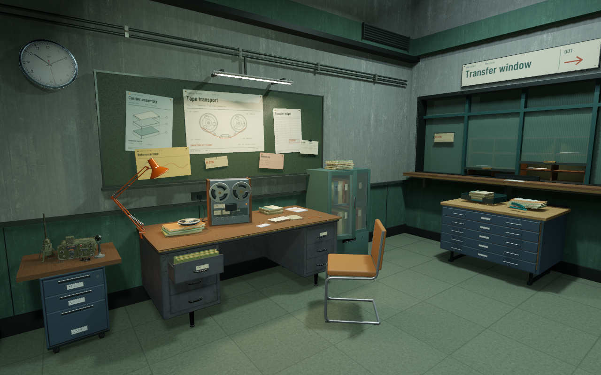

# Sound Archives · 声音档案交接处

在 Godot 4.7.2 中打开 [project.godot](project.godot)，等待导入后按 **F5**。入口是 [final.tscn](final.tscn)，开场位于档案门前。画面采用 Metal Forward+，项目分辨率为 1280 × 800。

## 查看与试玩

| 按键 | 操作 |
| --- | --- |
| 5 / 6 / 7 | 门洞 / 工作角 / 桌边近景 |
| 1 / 2 | 第一人称 / 第三人称玩家 |
| 3 | 自由相机，WASD 与鼠标移动、转向，Q / E 降低、升高 |
| WASD、鼠标、Space | 玩家行走、转向与跳跃 |
| Esc、单击窗口 | 释放、重新捕获鼠标 |

从门洞能看见后方索引柜。沿右墙依次是收件架、核带桌与出库窗。桌上使用中的卷带、图板上的监录卡与窗口的取件标签共用卷号 M-0716。

## 同机位实图

| 阶段 | 门洞 | 工作角 | 近景 |
| --- | --- | --- | --- |
| [白盒](whitebox.tscn) | [door](captures/whitebox/door.png) | [props](captures/whitebox/props.png) | [close](captures/whitebox/close.png) |
| [素材小样 A](sample_a.tscn) | [door](captures/audition-a/door.png) | [props](captures/audition-a/props.png) | [close](captures/audition-a/close.png) |
| [素材小样 B](sample_b.tscn) | [door](captures/audition-b/door.png) | [props](captures/audition-b/props.png) | [close](captures/audition-b/close.png) |
| [First](first.tscn) | [door](captures/first/door.png) | [props](captures/first/props.png) | [close](captures/first/close.png) |
| [Final](final.tscn) | [door](captures/final/door.png) | [props](captures/final/props.png) | [close](captures/final/close.png) |

两套小样使用同一组灯位，对照整墙、地面与相邻设备。首轮之后做了一次美术修订。终版门框的共面修复和修复前证据另列于 [复查记录](REVIEW.md)。本包可通过 `python3 render.py import` 导入，复拍时给 `python3 render.py capture final.tscn captures/新目录名` 使用尚未存在的目录。

## 编辑位置与范围

- [final.tscn](final.tscn) 继承白盒，保留 `BaseLab`。在 `Art` 下可分别打开 [门套](art/final/Threshold.tscn)、[围护与梁](art/final/Structure.tscn)、[工作站](art/final/Registry.tscn)、[交接窗](art/final/ReleaseWindow.tscn)、[周转台](art/final/TransitCases.tscn) 和 [地坪镶条](art/final/LevelFloor.tscn)。灯具和光源位于主场景 `Art/InteriorLight` 与各自工位场景内。
- 墙边家具使用独立的简化碰撞。原实验室的门、坡道、台阶、跳台继续使用白盒碰撞；门框压边位于 1.2 × 2.3 m 通行净空以外，金属条与门槛齐平。
- 模型和 PBR 图位于 `art/models/`、`art/surfaces/`。纸张、门牌、仪表刻度可在 `art/printing/` 和 `art/final/printing/` 替换。[素材与许可](ASSETS.md) · [参考与实现假设](RESEARCH.md)

## 可见不足

工作角右缘越过折墙后，侧通道只完成了上方围护和相邻地面。近景中档夹仍叠得较整齐，卷带盒的小字号在工作角机位只能辨认标签位置。其余实验区沿用原白盒，远景地面做了连续的基础覆面。
