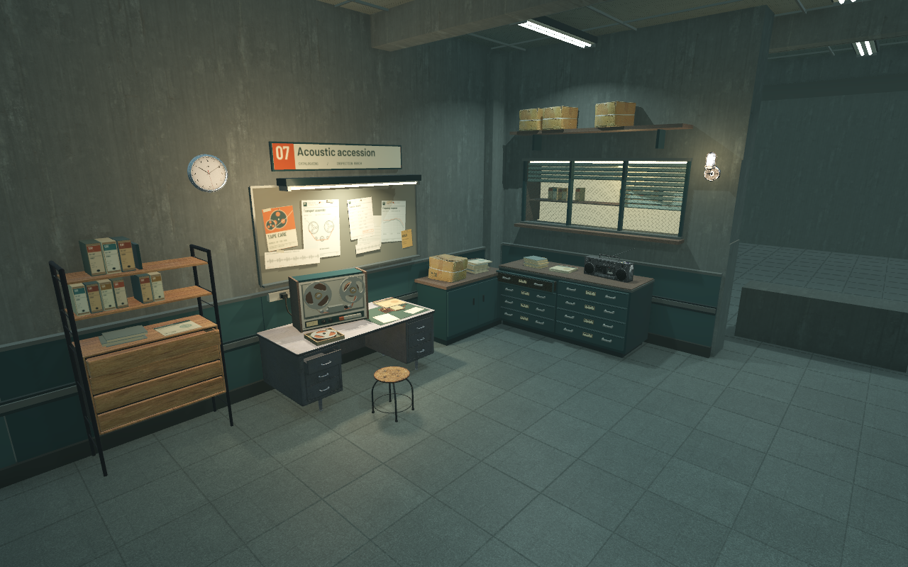

# Sound Records 07 · 声像档案交接处

在原白盒门洞后，右墙是一张检查盘带与登记来件的办公桌，回墙设平档柜和带夹丝玻璃的移交窗。门楣与工位使用相同的 07 编号。

## 打开与试玩

用 Godot 4.7.2 打开本目录的 project.godot，按 **F5** 进入 final.tscn。初始画面为门洞。按 **5 / 6 / 7** 切换门洞、工位总览和桌面近景。**1 / 2** 进入第一或第三人称，**3** 启用自由相机。点击画面捕获鼠标，WASD 移动、鼠标转向、Space 跳跃、Esc 释放鼠标。

BaseLab 保留原测试场实例与控制器。编辑 final.tscn 的 Art 子树可调整门框、顶棚、柜台、文件、灯具与陈设。盘带机和八屉平档柜也可作为独立场景编辑。原有碰撞体、坡道、阶梯、跳台及 1.2 × 2.3 m 门洞净空均保留。新增家具碰撞集中在靠墙的工作角。

## 制作与实图

|阶段|可编辑场景 / 依据|固定机位|
|---|---|---|
|参考方向|[观察及制作假设](RESEARCH.md) · [冻结图出处](REFERENCES.md)|[原白盒](captures/whitebox/door.png)|
|材料小样 A|[木模混凝土与水磨石](sample_a.tscn)|[整墙](captures/sample-a/props.png) · [近景](captures/sample-a/close.png)|
|材料小样 B|[预制板与油毡](sample_b.tscn)|[整墙](captures/sample-b/props.png) · [近景](captures/sample-b/close.png)|
|首轮|[first.tscn](first.tscn)|[门洞](captures/first/door.png) · [工位](captures/first/props.png) · [近景](captures/first/close.png)|
|一次自主修订|[final.tscn](final.tscn)|[门洞](captures/final/door.png) · [工位](captures/final/props.png) · [近景](captures/final/close.png)|

两组小样与两轮制作均通过包内 python3 render.py 导入或重开拍摄，使用相同的 Metal Forward+、1280 × 800 和 views.json。需要重拍时，给 capture 命令指定新的输出目录。外部素材的作者、免费文件、使用方式及许可见 [ASSETS.md](ASSETS.md)。

## 范围与不足

制作范围到门洞与右侧工作角为止。邻接处续接地面、围护、百叶和顶面，外围坡道、台阶区域仍然是测试布局。从门口看，原跳台改作的承台依然方整；近看台灯正下方的表单，细线对比偏低。逐机位的修订依据和剩余问题见 [REVIEW.md](REVIEW.md)。
