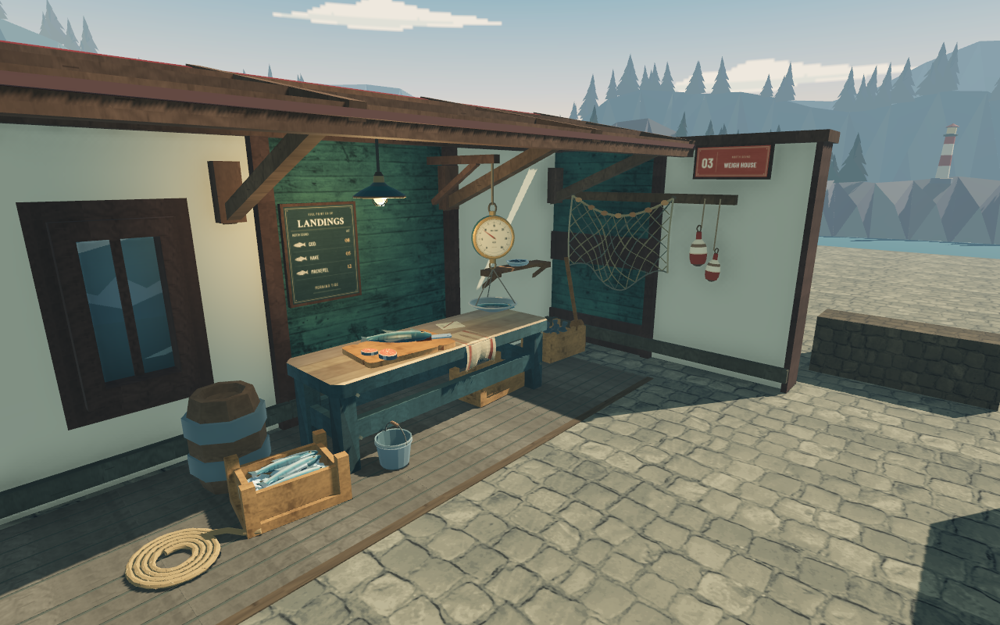

# Gull Point 鱼货交接所

门楼后的右墙有一座半开放鱼棚。鱼从铺冰的来货箱送上砧板，过秤后在台边填单。门前的货运墩沿用原来的三个跳台高度。

## 打开与试玩

用 Godot 4.7.2 打开本目录的 [project.godot](project.godot)，完成导入后按 **F5** 进入 [final.tscn](final.tscn)。画面从门楼机位开始。

| 按键 | 用途 |
| --- | --- |
| 5 / 6 / 7 | 门楼 / 工作角 / 台面近看 |
| 1 / 2 | 切换第一、第三人称玩家 |
| 3 | 自由相机，E / Q 升降 |
| WASD、鼠标、Space | 移动、转向、跳跃 |
| Esc、单击游戏窗口 | 释放、重新捕获鼠标 |

## 同机位实图

| 阶段 | 门楼 | 工作角 | 台面 |
| --- | --- | --- | --- |
| [A · 绿漆木板](sample_a.tscn) | [门楼](captures/boards/door.png) | [整墙](captures/boards/props.png) | [近看](captures/boards/close.png) |
| [B · 浅色灰泥](sample_b.tscn) | [门楼](captures/limewash/door.png) | [整墙](captures/limewash/props.png) | [近看](captures/limewash/close.png) |
| [First](first.tscn) | [门楼](captures/first/door.png) | [工作角](captures/first/props.png) | [台面](captures/first/close.png) |
| [Final](final.tscn) | [门楼](captures/final/door.png) | [工作角](captures/final/props.png) | [台面](captures/final/close.png) |

参考方向、素材小样、首轮场景和自主修订分别提交。全部实图经本包 render.py 重开已保存的场景拍摄，使用 Godot 4.7.2、Metal Forward+ 和固定 1280×800 视口。复拍可在本目录用命令 `python3 render.py capture final.tscn captures/new-review`，输出目录须是新目录。

## 编辑范围

- 主场景继承 [whitebox.tscn](whitebox.tscn)，其中 BaseLab 提供玩家、相机和原碰撞。在 Art 下可分别选取门楼、鱼棚、相邻的后库立面、货运墩和远岸。
- [终版鱼棚](art/final/Weighhouse.tscn)按围护、挑檐、来货箱、称切台和晾网分组。[门楼](art/final/Gate.tscn)和[台边补件](art/final/Packing.tscn)可以单独打开。木板、鱼、秤和渔具均是可替换的网格实例。
- 改动过的资源存入 [art/final](art/final/)。共用的成熟模型保留在 [art/kit](art/kit/) 与 [art/tackle](art/tackle/)。首轮场景、依赖和三张图冻结在提交 `7723d4c`。
- 铺石连续覆盖原地面。坡道、台阶和局部外的训练场保留原形；海面位于原地块外围。17 个原静态体与 18 个碰撞形状的变换已逐项比对，形状资源一致。终版门洞的 1.2 × 2.3 米净空以 1 毫米容差检查通过。

## 可见不足

近看时，搁架左端仍与秤的一根悬线重合，发亮的灯罩底部也缺少层次。棚外能看到远岸，云边与部分山体切面在固定机位上较硬。更远的训练区保留白盒。

参考观察见 [RESEARCH.md](RESEARCH.md)，素材文件、免费范围与许可见 [ASSETS.md](ASSETS.md)，首轮诊断及逐机位复核见 [REVIEW.md](REVIEW.md)。
