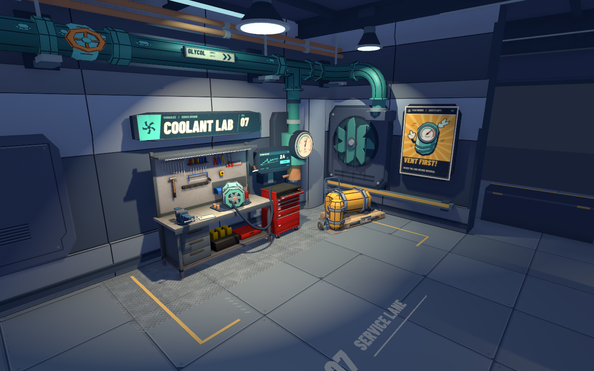

# 07 号冷却单元交接站

从地面箭头穿过开放的交接门，右侧是回路检测台。台上的青色开口件露出叶轮，靠墙的黄色封装件放在手推车和托盘上。抬头可以沿带法兰的供管找到风机上方的回弯。

## 打开与试玩

用 Godot 4.7.2 打开 [project.godot](project.godot)，按 **F5** 进入 [final.tscn](final.tscn)。启动时从门口观察。按 **5 / 6 / 7** 分别切换门洞、工作角全景和台前近景。按 **1 / 2** 切换第一或第三人称玩家，**3** 进入自由相机。点击画面捕获鼠标，WASD 移动、鼠标环视、Space 跳跃，Esc 释放鼠标。

场景继承 [whitebox.tscn](whitebox.tscn)。原白盒实例名为 `BaseLab`；门洞净宽 1.2 m、净高 2.3 m，门槛格栅画在原地面上。跳台、台阶和坡道保留原来尺寸与碰撞。道具与新标识均为视觉件。编辑时展开 `Art` 下的 `TransferGate`、`CoolingCircuit`、`Enclosure`、`TransportSkids` 或 `PracticalLighting` 可分别调整门框、工位、墙面、跳台覆面与灯位。

## 制作阶段与同机位实图

| 阶段 | 门洞 | 工作角 | 近景 |
| --- | --- | --- | --- |
| [原白盒](whitebox.tscn) | [door](captures/whitebox/door.png) | [props](captures/whitebox/props.png) | [close](captures/whitebox/close.png) |
| [首轮](first.tscn) | [door](captures/first/door.png) | [props](captures/first/props.png) | [close](captures/first/close.png) |
| [自主修订后的终轮](final.tscn) | [door](captures/final/door.png) | [props](captures/final/props.png) | [close](captures/final/close.png) |

起点是两张冻结的《Hi-Fi RUSH》参考。素材阶段先铺满右墙，对照两类墙板，并用普通着色复核同一阀轮与筒盖的读形。随后保存并冻结首轮，再将一次美术修订写入独立的最终场景。可查阅 [参考与方向](RESEARCH.md)、[素材、小样与许可](ASSETS.md) 和 [两轮评图、技术修复](REVIEW.md)。

GPU 导入与两轮出图均使用 `python3 render.py`。实拍为 Godot 4.7.2、Metal Forward+、1280 × 800。复拍时给渲染脚本一个新目录，例如 `python3 render.py capture final.tscn captures/another-final-check`。项目主场景另做过一次无窗口启动；本机返回了 macOS 系统 CA 查询错误，随后加载完成 final、whitebox 和 controller_lab，进程以 0 退出。两轮 Metal 拍摄日志均记录了三个机位成功写出。

## 可见边界

台面小工单在固定近景下仅能辨出轮廓，工具挂板仍有细碎颗粒。门后的围护只做到浅观察窗、检修板与卷帘，远侧细节密度低于工位。制作范围之外保留白盒测试区，台阶与坡道只处理了局部视野所需的衔接。
