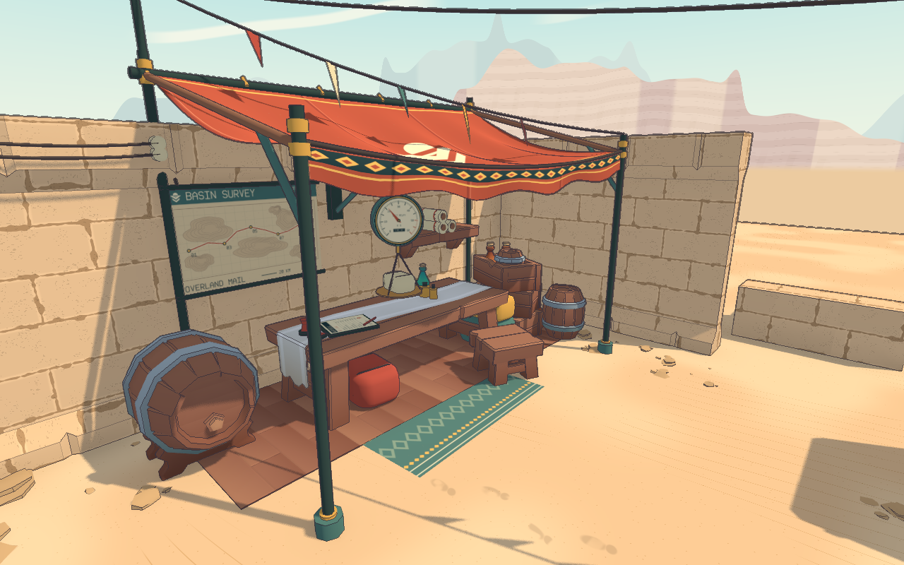

# 盐路七号转运站 · Salt Relay 07

一个可试玩的露天沙漠货运角。旅客从带翼形日轮的门冠下穿过，右墙红棚下摆着运单、线路图、砝码与吊秤。制作范围集中在门洞与称量工位。

## 打开与编辑

在 Godot 4.7.2 中打开本目录的 project.godot，按 **F5** 进入 [final.tscn](final.tscn)。**5 / 6 / 7** 分别进入门洞、工位全景和近景。**1 / 2** 进入第一、第三人称，**3** 切自由相机。WASD 与鼠标移动观察，Space 跳跃，Esc 释放鼠标。

原白盒实例保留在 BaseLab。碰撞、玩家和相机来自原场景，视觉覆面与新增节点位于本场景。Art/Portal 可编辑门冠，ShadeRig 管棚布与拉索，WeighHouse 管秤具与台边货物，SurveyAndSeals 管线路图、货签和卸货垫。坡道、台阶及跳台延用原通行形状；局部以外沿用实验场布局，仅做连续地面与边界覆面。

## 阶段实图

| 阶段 | 门洞 | 工位全景 | 秤台近景 |
| --- | --- | --- | --- |
| [小样 A](sample_a.tscn) | [door](captures/sample-a/door.png) | [props](captures/sample-a/props.png) | [close](captures/sample-a/close.png) |
| [小样 B](sample_b.tscn) | [door](captures/sample-b/door.png) | [props](captures/sample-b/props.png) | [close](captures/sample-b/close.png) |
| [First](first.tscn) | [door](captures/first/door.png) | [props](captures/first/props.png) | [close](captures/first/close.png) |
| [Final](final.tscn) | [door](captures/final/door.png) | [props](captures/final/props.png) | [close](captures/final/close.png) |

两轮均使用冻结机位与 1280 × 800 Metal Forward+ 输出。需要复拍时，在本组运行 `python3 render.py import`，然后运行 `python3 render.py capture final.tscn captures/new-check`，输出目录须尚未存在。

## 复看要点

终稿从门冠旗索可以追到右墙棚架，近景能看到托盘内的货包与桌上的登记工具。固定工位全景的前柱会挡住线路图一角，货包侧面与桶身仍偏平。首轮保留了当时的杆索方向问题和圆件 ID 警告，终稿已修复。具体观察与技术复拍记录见 [REVIEW.md](REVIEW.md)，冻结图的转译见 [RESEARCH.md](RESEARCH.md)，来源、许可和改造见 [ASSETS.md](ASSETS.md)。
