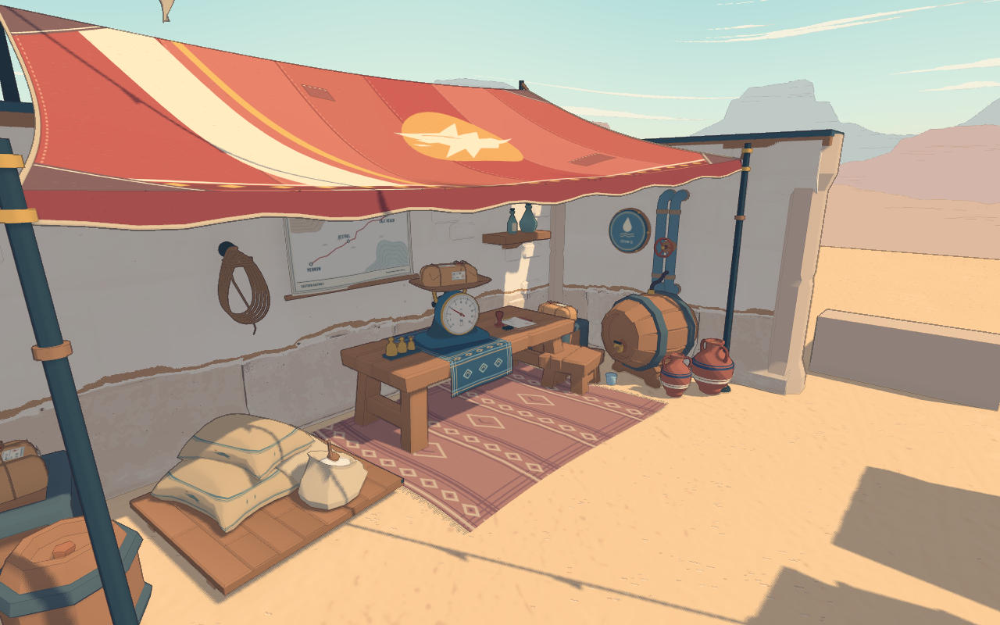

# 盐风驿 · 第七称量站

沙地门标通向一处露天补给角。北侧木托盘接收盐袋，中央秤台称量封包、开具货单，短墙下的桶和陶罐用于配水。

## 打开与试玩

用 Godot 4.7.2 打开本目录的 `project.godot`，资源导入完成后按 **F5**。默认从门口看向驿站。工程使用 Metal Forward+，固定截图为 1280 × 800。[终版场景](final.tscn)

| 操作 | 按键 |
| --- | --- |
| 门洞 / 工作角总景 / 秤台近景 | **5 / 6 / 7** |
| 玩家第一人称 / 第三人称 | **1 / 2** |
| 自由观察 | **3**，WASD 移动，E / Q 升降 |
| 玩家移动 | **WASD**，鼠标转向，**Space** 跳跃，**Shift** 加速 |
| 释放 / 捕获鼠标 | **Esc** / 单击场景 |

## 同机位对照

| 可编辑场景 | 门洞 | 工作角 | 近看 |
| --- | --- | --- | --- |
| [白盒](whitebox.tscn) | [door](captures/whitebox/door.png) | [props](captures/whitebox/props.png) | [close](captures/whitebox/close.png) |
| [小样 A · 石面晕染](sample_a.tscn) | [door](captures/sample-a-wash/door.png) | [props](captures/sample-a-wash/props.png) | [close](captures/sample-a-wash/close.png) |
| [小样 B · 石缝与细线](sample_b.tscn) | [door](captures/sample-b/door.png) | [props](captures/sample-b/props.png) | [close](captures/sample-b/close.png) |
| [首轮](first.tscn) | [door](captures/first/door.png) | [props](captures/first/props.png) | [close](captures/first/close.png) |
| [自主修订终版](final.tscn) | [door](captures/final/door.png) | [props](captures/final/props.png) | [close](captures/final/close.png) |

参考方向提交为 `1fe0b6c`，小样为 `2d37b30`，首轮冻结于 `0aa3222`。两轮正式图均从磁盘上的场景重开拍摄。本组需重拍时，使用 `python3 render.py import`，再用 `python3 render.py capture final.tscn captures/新目录名` 写入独立目录。

## 编辑与范围

在终版的 `Art` 下，可分别打开门楼、砌体、遮阳帆、货物、秤台和配水组件。机械秤的指针、刻度盘、托盘和包件可单独选择。修订资源放在 `art/final/`；原始 GLB、采样表面和字体保存在 `art/sources/`。完整素材许可、映射尺度及小样选择见 [ASSETS.md](ASSETS.md)。

原白盒以 `BaseLab` 实例保留。门洞净宽 **1.2 m**、净高 **2.3 m**。跳台顶板与原落脚面齐平，右侧工作角另有桌、载货木托和水桶的局部碰撞。主要制作限于门洞、装卸台和右墙内侧；公共地面与相邻围护做了连续覆面，坡道、远端平台及出生区仍保留白盒构造。远山随天空绘制。

总景的红帆遮住地图标题，切近景能看全路线。背墙的石带仍有周期性，木凳和水桶的折面比陶罐更硬。三机位的修订得失与技术记录见 [REVIEW.md](REVIEW.md)；图像依据及场景设定见 [RESEARCH.md](RESEARCH.md)。
