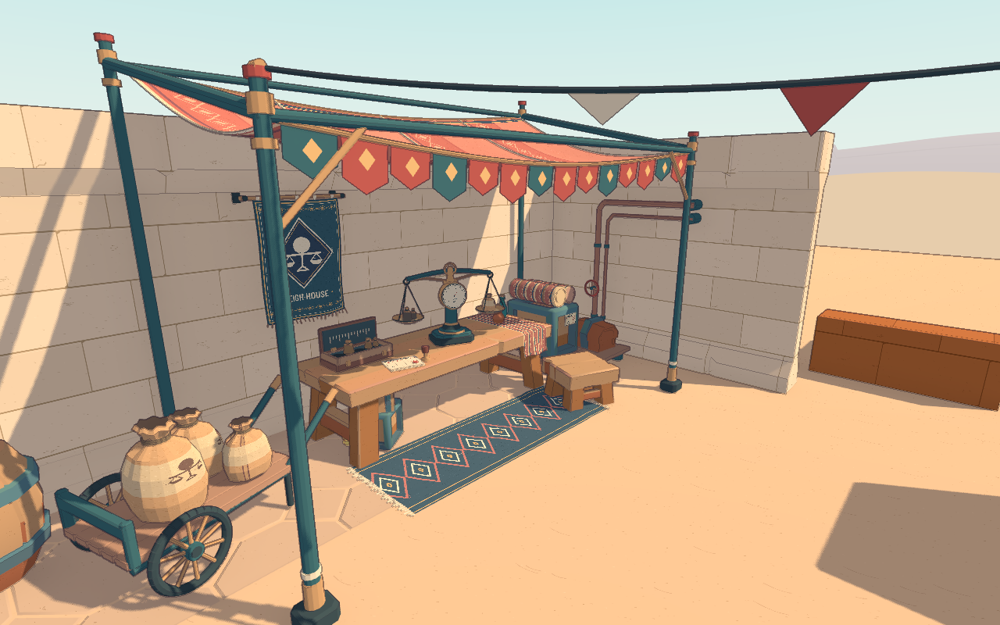

# 盐路七号 · 露天过秤站

用 Godot **4.7.2 Forward+** 打开 [project.godot](project.godot)，按 **F5** 进入 [final.tscn](final.tscn)。开场从里程门望向右墙。小车上的盐袋等着取样，台上留着校准砝码和盖印单据，右端托盘存放已经捆扎的出站货。

## 试玩与编辑

- **5 / 6 / 7** 切到门洞、工作角全景和柜台近景。
- 在游戏窗口单击捕获鼠标，**1 / 2** 进入第一或第三人称，**3** 切换自由相机。**WASD** 移动，鼠标环视，玩家模式下 **Space** 跳跃，**Esc** 释放鼠标。
- 在编辑器展开 `Art`。门牌与石拱在 `MilestoneGate`，棚架和棚布在 `Shade`，秤、砝码盒和封签用品在 `WeighDesk`，手车与出站货在 `Consignments`。道具为独立 GLB 实例，图案在 `art/prints`。
- `BaseLab` 实例承载原碰撞与控制器。局部以门洞和右墙为界，后墙只做连续围护，坡道、台阶和远端练习区沿用白盒形体。新增道具为视觉陈设。

## 制作阶段

| 阶段 | 记录与重开实图 |
| --- | --- |
| 参考方向 | [冻结图观察、设计依据及制作假设](RESEARCH.md) |
| 素材小样 | [暖灰泥拱龛](captures/recess/props.png) · [浅砌石直墙](captures/ashlar/props.png) · [选材与许可](ASSETS.md) |
| 首轮 | [first.tscn](first.tscn) · [门洞](captures/first/door.png) · [工作角](captures/first/props.png) · [近景](captures/first/close.png) |
| 自主修订 | [final.tscn](final.tscn) · [门洞](captures/final/door.png) · [工作角](captures/final/props.png) · [近景](captures/final/close.png) |

所有交付实图均由本组 `python3 render.py` 重开保存场景，以固定机位、1280 × 800、Metal Forward+ 拍摄。如需复拍，执行 `python3 render.py import`，再执行 `python3 render.py capture final.tscn captures/my-new-review`，输出目录须为新目录。

终图全景的前柱仍遮住一部分挂旗。门外铺石与沙面之间有较直的分界，近景运单上的小字在固定视距下只能辨为印刷痕迹。首终对照及盒盖导出修复见 [REVIEW.md](REVIEW.md)。
