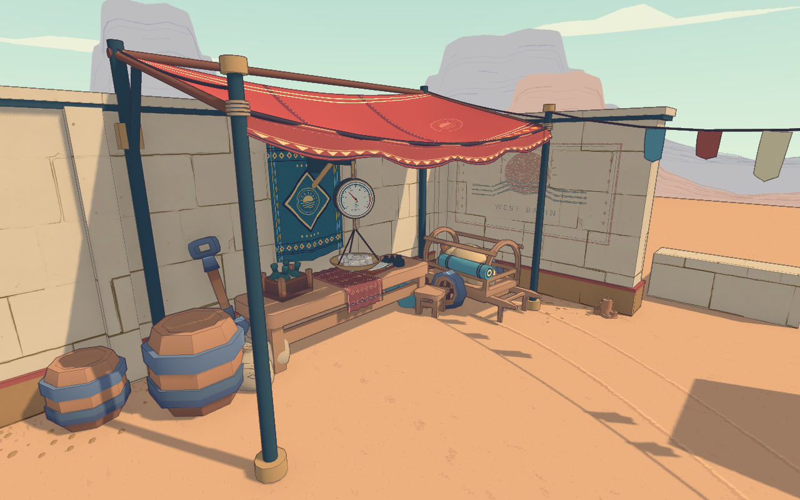

# 盐路七号 · 露天称重驿站

用 Godot **4.7.2 Forward+** 打开 `project.godot`，按 **F5** 进入 [final.tscn](final.tscn)。初始视角对准门洞。**5 / 6 / 7** 分别看门洞、墙边工作角与近景；**1 / 2** 切换第一、第三人称，**3** 自由观察。WASD 移动，鼠标转向，Space 跳跃，Esc 释放鼠标，单击再次捕获。

## 对照同一机位

| 阶段 | 门洞 | 工作角 | 近景 |
| --- | --- | --- | --- |
| [小样 A · 淡石缝](sample_a.tscn) | [door](captures/sample-a/door.png) | [props](captures/sample-a/props.png) | [close](captures/sample-a/close.png) |
| [小样 B · 蚀刻缝与轮廓](sample_b.tscn) | [door](captures/sample-b/door.png) | [props](captures/sample-b/props.png) | [close](captures/sample-b/close.png) |
| [首轮](first.tscn) | [door](captures/first/door.png) | [props](captures/first/props.png) | [close](captures/first/close.png) |
| [一次自主修订后的终轮](final.tscn) | [door](captures/final/door.png) | [props](captures/final/props.png) | [close](captures/final/close.png) |

## 编辑与范围

门洞连到沿墙的盐货称重处。上秤的粗盐、取样瓶、登记簿和双轮车对应称重、登记和装运。打开最终场景后，在 `Art/SaltGate` 编辑门额和旗具，在 `DyersAwning`、`WeighHouse` 和 `SaltFreight` 编辑棚、秤台和货物。源模型与材质可以单独替换，场景无需运行构建器。

`BaseLab` 实例承载原控制器和全部原始碰撞。门洞净口为 1.2 × 2.3 m，原跳台高度为 0.4、0.9、1.4 m；货箱外观和木盖按这三个高度配合。坡道与台阶仅做表面衔接。出生点以及局部以外的场地继续采用白盒布局。远山绘在天空全景中。

右棚前柱在工作角视图中遮住部分盐袋。近景能看见秤针和盐块，账页小字仍受斜视角限制。门后长墙的砌缝也比冻结参考更规律。[图像诊断与修订](REVIEW.md) · [素材及许可](ASSETS.md) · [参考依据](RESEARCH.md)

复拍时用 `python3 render.py import` 完成导入，然后运行例如 `python3 render.py capture final.tscn captures/recheck-01`。每次选用新目录。交付图均由此入口从保存的场景实际渲染，固定 1280×800。
