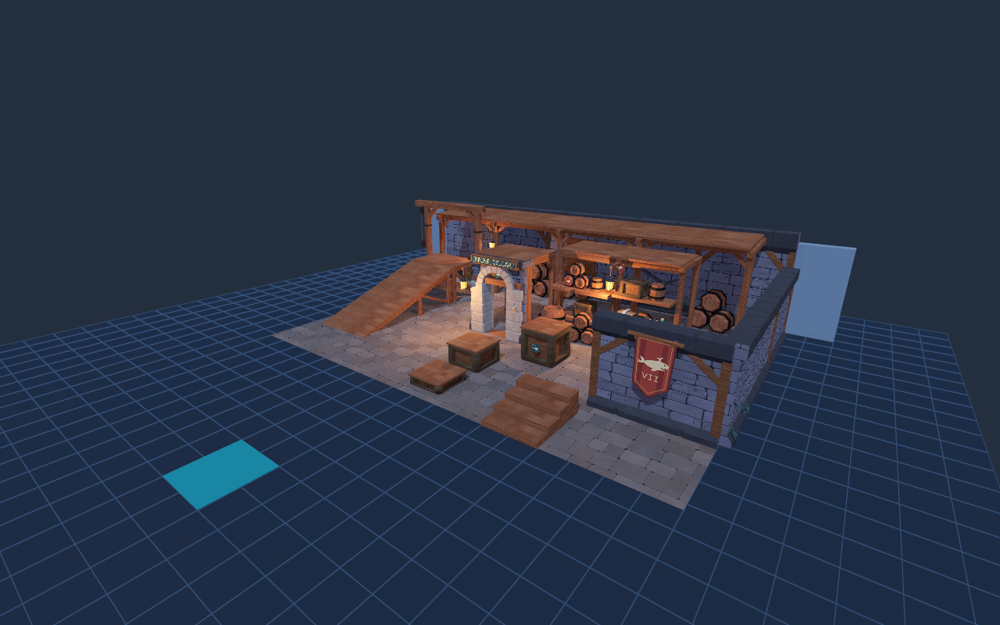
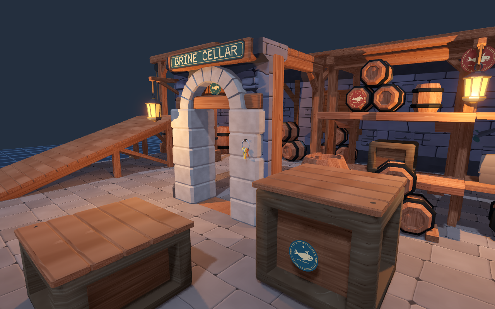
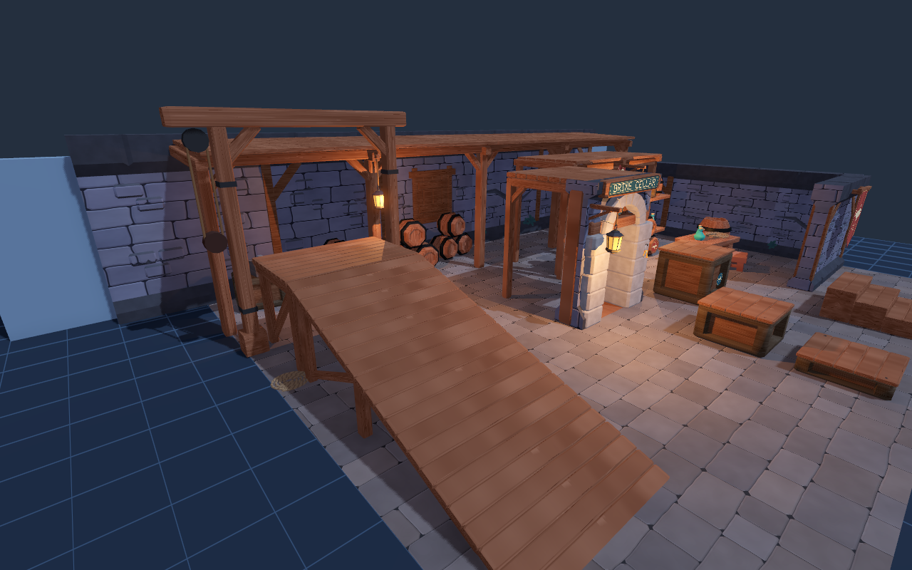

# Port Merrick 酒馆地窖局部

在 Godot 4.7.2 中打开 project.godot，按 **F5** 进入已保存的 draft.tscn。默认显示整体书签。**5** 查看整体，**6** 查看储藏门与桶架，**7** 从左坡道检查高位平台和门洞。沿用 inspection.tscn 内的玩家与相机控制器。**1 / 2** 切换第一、第三人称，**WASD** 移动，**空格** 跳跃，**F** 切换自由观察。

| 整体 | 门洞近景 | 坡道过渡 |
| --- | --- | --- |
| [](captures/final/overall.png) | [](captures/final/close.png) | [](captures/final/transition.png) |

**当前阶段为 awaiting_user_calibration。** 已交付储藏入口、右侧分装桶架、左侧搬运坡道与相连石板地面。蓝色网格、SpawnPad、后墙端部、前场及其余外围属于未完成区域。当前屋顶只覆盖门廊和后部工作带，固定高机位可检查本段布局。

### 编辑

draft.tscn 内的 BaseWhitebox 以单位变换引用冻结的 source/whitebox.tscn。17 个原物理体、碰撞形状和层掩码由该实例提供。视觉节点独立分组，可直接在编辑器中修改。Masonry 负责门洞与围护，Paving 对应地面，Cooperage 包含桶架、取样龙头和分装桌，LoadingWay 对应坡道、跳台、台阶与起吊架，Warehouse 包含后棚与进货暂存区，LightRig 管理照明，Signage 管理绘制标识。

需要重拍时，在项目根目录执行下列命令。第二条使用一个尚未存在的目录名。

```sh
python3 render.py import
python3 render.py capture draft.tscn captures/new-review
```

[原白盒与参考解读](RESEARCH.md) · [素材和许可](ASSETS.md) · [阶段对照与自查](REVIEW.md)
